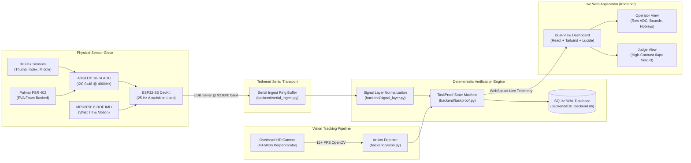

# RehabBridge NEXUS / H10 — Project & Application Explanation

**Event:** Innovation 2K26, College of Engineering, Phaltan (3–4 November 2026)  
**System:** RehabBridge NEXUS / H10 (AI-Assisted Task Verification Platform)  
**Audience:** Hackathon Judges, Clinical Evaluators, and Core Engineering Team  

---

## 1. Executive Summary: The Core Idea

### The Clinical Problem
Stroke survivors and motor-impaired physical therapy patients require hundreds of daily repetitions of meaningful motor tasks to rebuild neural pathways (neuroplasticity). In clinical settings, therapists supervise these exercises using standardized assessments like the Action Research Arm Test (ARAT) or Box and Block Test. 

However, when patients practice exercises at home:
1. **Unverifiable Repetitions:** Conventional digital therapy apps or smart gloves merely count isolated finger bends or estimate joint angles from webcam video. They cannot distinguish between a patient actually picking up an object versus merely curling their fingers in the air.
2. **Compensatory Movements:** Patients frequently cheat motor exercises using torso swinging or shoulder hiking without activating hand grasp muscles.
3. **No Objective Tele-Audit:** Clinicians receive unverified self-reports and cannot assess true motor recovery.

### The NEXUS Solution: Dual-Modality TaskProof
RehabBridge NEXUS is an engineering demonstrator that pairs an **instrumented sensor glove** with an **overhead computer vision camera** tracking an **ArUco fiducial marker** on a standardized physical transfer object (a 28g foam cube).

Instead of counting finger bends, our deterministic **TaskProof state machine** mathematically proves that the patient completed an actual functional real-world manipulation task:
$$\text{Contact Established} \longrightarrow \text{Stable Lift} \longrightarrow \text{Spatial Transport} \longrightarrow \text{Target Zone Release}$$

If all four kinematic and contact guards pass, the system emits an unambiguous **`VERIFIED`** verdict. If the camera view is occluded, or if sensor telemetry is lost, the engine refuses to guess and yields **`UNCERTAIN`**.

---

## 2. End-to-End Application Architecture

### The 7-State Verification Lifecycle
The TaskProof engine enforces a strict linear state machine:
1. **`IDLE`**: Waiting for preflight confirmation and user initiation.
2. **`WAITING_FOR_GRASP`**: Transfer cube must be stationary inside Zone A (start zone).
3. **`GRASPED`**: Palmar FSR detects contact closure (above calibrated threshold $\approx 0.5\text{ N}$) while flex sensors indicate closure.
4. **`LIFTED`**: ArUco marker elevates vertically above table surface ($z$-displacement $> 30\text{ mm}$) while contact remains continuously engaged.
5. **`TRANSPORTING`**: Marker coordinates transition across the physical zone boundary with smooth kinematic velocity (monitored via dimensionless jerk).
6. **`IN_TARGET_ZONE`**: Marker enters Zone B boundary coordinates while contact remains engaged.
7. **`RELEASED`**: FSR force drops below release threshold and fingers extend, leaving the object stationary in Zone B.

**Verdicts Emitted:**
- **`VERIFIED`**: All kinematic, contact, and spatial guards satisfied.
- **`FAILED`**: Object dropped outside target zone, premature release, or boundary violation.
- **`UNCERTAIN`**: Camera occluded for $> 500\text{ ms}$, packet loss, or sensor drift.
- **`ABORTED`**: Operator intervention or volunteer stop request.

---

## 3. Team Roles & Project Ownership

| Team Member | Core Domain | Direct Ownership | Spoken Focus |
|---|---|---|---|
| **Krushna** | **Software & System Architecture** | Serial ingest, TaskProof engine, FastAPI backend, SQLite database, React dashboard | System design, mathematical verification, occlusion fail-safes, SQLite persistence. |
| **Vaishnavi Jare** | **Product Design & Volunteer UX** | User interface flow, Judge View, Operator View, Okabe-Ito colorblind palette, 48x48px accessibility | Human-centered clinical accessibility, high-contrast verdict cards, dual-view workflow. |
| **Rajendra** | **Hardware Electronics & Firmware** | ESP32-S3 firmware, ADS1115 ADC wiring, voltage dividers, MPU6050 IMU, disconnect fail-safes | External analog front-end, 25 Hz sampling integrity, I2C bus wiring, electrical safety. |
| **Gautam** | **Glove Mechanics & Validation** | Floating sensor guide sleeves, palmar EVA foam buffer, 28g ArUco cube, physical bench trials | Mechanical strain relief, eliminating sensor buckling, contact repeatability, physical demo. |

---

## 4. Empirical Grounding & Hardware Cost

Every statement in our demonstration is backed by measurable evidence in the repository:

1. **Hardware Cost (Active System: ₹6,180 | With Spares: ₹8,400):**
   - Sourced item-by-item in [`docs/BOM.csv`](file:///c:/Users/Krushna/OneDrive/Documents/projects%20for%20github/asthavakra/docs/BOM.csv).
   - ESP32-S3 DevKit (₹850), 3x Spectra Symbol Flex Sensors (₹3,600), Interlink FSR 402 (₹450), ADS1115 16-bit ADC (₹350), MPU6050 IMU (₹180), glove, wiring, and transfer payload.
2. **Physical Trial Validation (10/10 Consecutive Attempts Verified):**
   - Bench test results logged in [`docs/VALIDATION_SHEET.csv`](file:///c:/Users/Krushna/OneDrive/Documents/projects%20for%20github/asthavakra/docs/VALIDATION_SHEET.csv).
   - Evaluated by `tests/test_e2e.py::test_e2e_10` with zero sensor dislocation, zero packet gaps, and 100% agreement with operator ground truth.
   - *Statistical Honesty:* 95% Wilson confidence interval is $[0.7225, 1.0000]$. Sample size $n=10$ is explicitly stated as too small for clinical reliability.
3. **Automated Test Verification (68/68 Passing Tests):**
   - Logged in [`docs/TEST_RESULTS.md`](file:///c:/Users/Krushna/OneDrive/Documents/projects%20for%20github/asthavakra/docs/TEST_RESULTS.md) across 10 suites: Contracts, Firmware Parity, Serial Ingestion, Vision Tracking, Signal Processing, TaskProof Engine, E2E Integration, NEXUS REST API, Backend, and ML.
   - All Gates G0 through G6 passed.

---

## 5. Live Demonstration Schedule (10 Minutes Total)

| Minute | Presenter | Action / Screen Shown |
|:---:|---|---|
| **0:00 – 1:15** | **Krushna** | Executive pitch, run preflight check, start live 25 Hz stream, explain TaskProof state machine. |
| **1:15 – 2:30** | **Vaishnavi** | Display Operator View, switch to Judge View, showcase 48x48px hit targets and Okabe-Ito palette. |
| **2:30 – 3:45** | **Rajendra** | Explain external 16-bit ADS1115 ADC, 25 Hz settling rate, GPIO 47 LED, trigger sensor disconnect guard. |
| **3:45 – 5:00** | **Gautam** | Don glove, demonstrate floating sleeves, perform live physical 28g cube transfer across Zone A to B. |
| **5:00 – 10:00** | **All 4 Members** | Field technical inquiries from judges adhering strictly to factual boundaries. |

---

## 6. What the Prototype Is NOT (Honest Boundaries)

To maintain scientific integrity during judging:
- **NOT a Certified Medical Device:** This is an engineering prototype for Innovation 2K26.
- **NO Clinical Diagnoses or Recovery Predictions:** The system does not diagnose motor pathologies or predict functional recovery.
- **NO Uncalibrated Force or Angles:** We report raw and normalized sensor units, never grip force in newtons or joint flexion in degrees without external load-cell calibration.
- **Live Failure Fallback:** If hardware fails live, say: *"The live glove is not responding, so I will show a recorded real session, marked REPLAY on screen."*
