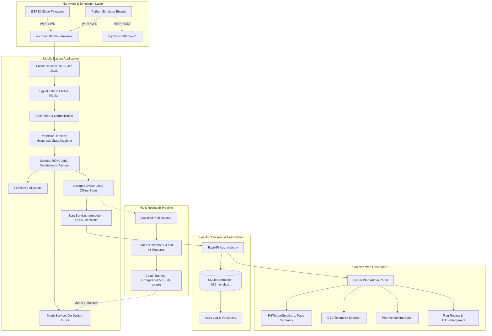

# H10 — System Architecture

---

## 1. Modular Subsystem Breakdown

### 1.1 Pure Dart Core Engine (`mobile/packages/h10_core`)
The mathematical and business-logic core of H10 is implemented in `h10_core`, a pure Dart package with zero Flutter dependencies:
- **PacketDecoder:** High-throughput 30-byte little-endian binary decoder with validation, timestamp monotonicity checking, gap tracking, and fallback JSON decoding.
- **Filters:** Exponential Moving Average (`EmaFilter`, default $\alpha=0.25$) and 5-point moving window `MedianFilter` for spike removal.
- **CalibrationEngine:** Two-stage median capture (Open Hand + Closed Fist) with stability standard deviation checks ($\sigma \le 120$ counts), minimum span validation ($\ge 300$ counts), polarity detection, and runtime baseline drift detection.
- **RepetitionDetector:** Robust hysteresis state machine (`idle` $\to$ `ascending` $\to$ `inflection` $\to$ `hold` $\to$ `descending` $\to$ `completed` / `rejected`) preventing double-counting with a 300 ms refractory period.
- **Kinematic Metrics:** Dimensionless jerk smoothness ($D_J$), intra-session consistency score (0–100 combining excursion ratio, timing CV, and smoothness), and fatigue drop index ($\Delta_{\text{peak}} \ge 20\%$).
- **SessionQualityGate:** Multi-factor stream validator checking packet loss ($< 5\%$), decode errors ($< 1\%$), sampling frequency stability ($50 \pm 5\text{ Hz}$), and sensor flatlining.
- **FeatureExtractor (`feat-v1`):** 84-dimensional feature vector extraction over sliding 2.0-second windows with exact mathematical parity to Python.
- **Recovery Analytics & Flags:** Baseline calculation, trend classification (improving, stable, declining, variable, plateau), and rule-based clinical flags.

### 1.2 Mobile Patient Application (`mobile/`)
A cross-platform Flutter application providing:
- **Accessible Patient Interface:** Large touch targets ($\ge 48\text{ dp}$), Okabe-Ito color-blind safe palettes, high-contrast typography, and persistent non-medical warnings.
- **Real-Time Visual Feedback:** CustomPainter 2D articulated hand, finger flexion bar gauges, and circular repetition progress indicator with target hold countdown.
- **Gamified Control:** Hand-control mini-game challenging patients to match isolated finger targets to score points while capturing kinematic metrics.
- **Offline Persistence & Sync:** Local storage allowing 100% offline rehabilitation, queued until a network connection to the FastAPI backend is detected.

### 1.3 Clinician Web Dashboard (`admin/`)
A responsive single-page web portal designed for physical therapists on 1280px+ desktop browsers:
- **Overview:** Clinic metrics, 7-day adherence, and priority flags requiring clinician acknowledgment.
- **Patient Cohort List:** Instant searching, side filtering, baseline status indicators, and open flag counts.
- **Patient Detail:** Multitab review of historical sessions, repetition trajectories, finger mobility radar/bars, and flag history.
- **Plan Versioning Editor:** Prescribe target reps, ROM bands, hold durations, and safety stop criteria. Modifying a plan automatically archives prior versions with an audit trail.
- **Reporting:** Automated 1-page clinical summary PDF generation (via `pdf` and `printing`) with mandatory disclaimers and CSV export.

### 1.4 FastAPI Backend (`backend/`)
- SQLite database with SQLAlchemy ORM.
- Enforces strict pseudonymization (`P-XXX`), rejecting any payload containing identifiable PII.
- Idempotent session ingestion: Duplicate identical submissions return `200 OK`; divergent payloads return `409 Conflict`.
- Plan versioning with non-destructive tombstone archiving.

