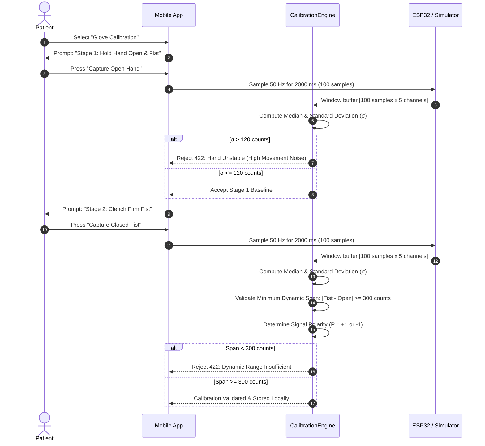

# H10 — Calibration & Drift Detection Engine

Calibration translates raw hardware ADC voltages into patient-specific Range of Motion (ROM) percentages.

---

## 1. Two-Stage Guided Calibration Procedure

---

## 2. Mathematical Acceptance Criteria

### 2.1 Stability Check
During the 2.0-second stationary holding window, patient tremor or inadvertent movement must not exceed the stability threshold:
$$\sigma_i = \sqrt{\frac{1}{N} \sum_{k=1}^N (x_i[k] - \bar{x}_i)^2} \le 120\text{ ADC counts}$$
If $\sigma_i > 120$ counts on any channel, the capture is rejected with code `CALIBRATION_UNSTABLE` and an on-screen prompt instructing the patient to rest their hand flat.

### 2.2 Minimum Dynamic Span
To prevent normalizing against an unresponsive or detached sensor, the dynamic span must satisfy:
$$\Delta_{\text{span}, i} = |M_{\text{fist}, i} - M_{\text{open}, i}| \ge 300\text{ ADC counts}$$
If $\Delta_{\text{span}, i} < 300$, the calibration is marked invalid (`SPAN_INSUFFICIENT`) and the patient is prompted to inspect glove fit and finger alignment.

### 2.3 Polarity Detection
Sensors can be installed in direct or inverted orientation:
$$P_i = \begin{cases} +1 & \text{if } M_{\text{fist}, i} > M_{\text{open}, i} \\ -1 & \text{if } M_{\text{fist}, i} < M_{\text{open}, i} \end{cases}$$

---

## 3. Runtime Baseline Drift Detection
During active usage, thermal drift, glove shifting, or sensor fatigue can cause baseline values to migrate. The engine evaluates the resting baseline during inter-repetition rest intervals:

$$\Delta_{\text{drift}, i} = \frac{|x_{\text{rest}, i} - M_{\text{open}, i}|}{\Delta_{\text{span}, i}} \times 100.0$$

- **Drift Warning:** If $\Delta_{\text{drift}, i} > 15\%$, a non-blocking diagnostic notification appears: *"Sensor calibration drift detected. Recalibration recommended."*
- **Auto-Prompt:** If drift persists across 3 consecutive sessions, the app flags a `calibration_drift_detected` clinical alert.
