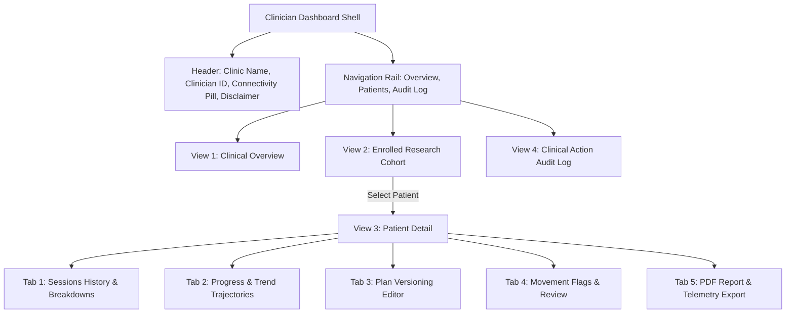

# H10 — Clinician Web Dashboard

The Clinician Web Dashboard (`admin/`) is an interactive desktop portal designed for physiotherapists to monitor rehabilitation progress, review movement quality alerts, and manage exercise prescriptions.

---

## 1. User Interface Structure

---

## 2. Views & Workflow

### 2.1 View 1: Clinical Overview
- **Metric Cards:**
  - Active Patients (Total enrolled in research study).
  - Open Clinical Flags (Amber warning alert with count of unreviewed items).
  - Sessions Completed Today (Daily adherence tracking).
  - 7-Day Adherence Rate (Cohort-wide average compliance percentage).
- **Priority Movement Flags Feed:**
  - Real-time feed of open movement alerts across all patients.
  - 1-Click "Acknowledge" button opening an interactive clinical review dialog.

### 2.2 View 2: Patient List
- Searchable and filterable table of all enrolled patients.
- Filter by affected side (`all`, `left`, `right`, `bilateral`).
- Direct indicators for baseline establishment status (`Established` vs `In Progress`).
- Quick navigation button to inspect individual patient telemetry.

### 2.3 View 3: Patient Detail (5 Tabs)
1. **Sessions:** Chronological session history with expandable tiles revealing per-repetition kinematics, hold times, and fatigue drops.
2. **Progress & Trends:** Visual progress bars tracking active ROM over time, plus 5-channel finger mobility breakdown using the Okabe-Ito color-blind safe palette.
3. **Plan Editor:** Inspects active plan parameters. Clicking *"Update / Version Plan"* opens a validated dialog requiring clinical justification, archiving the old version and provisioning the new prescription.
4. **Flags & Alerts:** Complete log of patient flags, highlighting severity (`review` vs `info`), rules violated, and clinician review notes.
5. **Export & Raw Data:**
   - **1-Click PDF Report:** Generates a publication-quality 1-page clinical rehabilitation summary report with mandatory non-medical prototype disclaimers.
   - **Telemetry CSV:** Exports raw session and repetition records for independent spreadsheet analysis or research statistics.

### 2.4 View 4: Clinical Action Audit Log
- Immutable chronological ledger recording all plan updates, versions, and flag acknowledgments with clinician identifiers and justifications.

