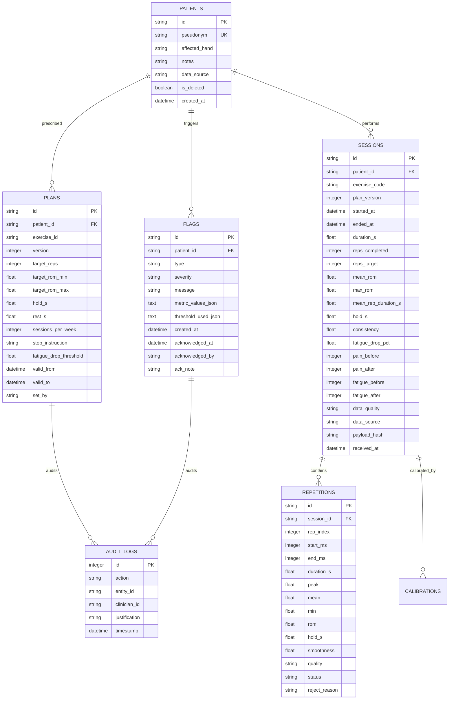

# H10 — Database Schema & Architecture

The database is built on SQLite using SQLAlchemy ORM (`backend/models.py`), structured for fast relational queries, non-destructive auditability, and pseudonymized patient privacy.

---

## 1. Entity-Relationship Diagram

---

## 2. Table Specifications

### 2.1 `patients`
- Primary key: `id` (UUID).
- `pseudonym`: Unique constraint (e.g. `P-014`). No patient names, phone numbers, or emails are stored.
- `is_deleted`: Tombstone boolean flag for soft deletion.

### 2.2 `plans`
- Versioning: `version` monotonically increments (v1, v2, v3...) upon modification.
- Validity windows: `valid_from` and `valid_to` track temporal activation; previous plans are archived, never overwritten.

### 2.3 `sessions`
- `payload_hash`: SHA-256 hash of core telemetry fields used to guarantee idempotency on retry.
- `data_source`: Marked `'real'` or `'simulated'`.
- `data_quality`: `'good'`, `'reduced'`, or `'invalid'`.

### 2.4 `repetitions`
- Detailed breakdown of each segmented cycle within the session.
- Tracks peak excursion, mean, dimensionless jerk smoothness, hold time, and validation status (`complete`, `interrupted`, `rejected`).
