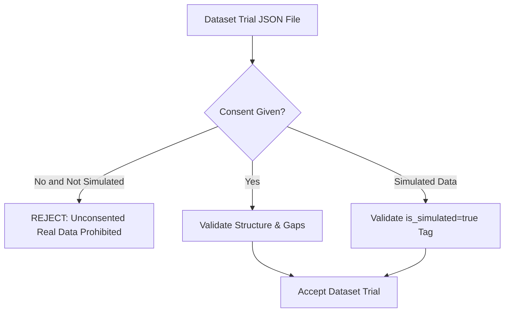

# H10 — Data Collection Protocol & Ethical Boundaries

Rigorous data integrity, participant consent verification, and synthetic labelling standards are enforced across every level of H10.

---

## 1. Ethical Boundary & Research Consent Enforcement

The dataset validation pipeline (`ml/dataset_validator.py`) enforces strict consent verification rules:

### 1.1 The Golden Consent Rule
- Any real human participant trial must have `"consent_given": true` and a valid pseudonymized identifier (`P-XXX`).
- If `"consent_given": false` and `"is_simulated": false`, the dataset validator **immediately rejects** the trial file with an error. No unconsented data is permitted in the training corpus.

### 1.2 Synthetic Data Labelling
- All data generated by the software simulator (`simulator/`) or synthetic dataset generators (`ml/generate_synthetic_dataset.py`) is permanently flagged with `"is_simulated": true` and `"data_source": "simulated"`.
- This tag persists through:
  - Binary and JSON telemetry packets
  - Repetition and session records
  - Backend SQLite database storage
  - Clinician dashboard session tables (yellow `SIMULATED` badge)
  - PDF clinical summary reports (`INCLUDES SIMULATED DATA` banner)
  - Telemetry CSV exports

---

## 2. Standardized Trial Collection Protocol
When recording a rehabilitation exercise trial:
1. **Participant Briefing:** Explain the research scope, emphasize non-medical monitoring nature, and obtain signed written informed consent.
2. **Glove Fitting & Comfort Check:** Select appropriate glove size (left/right). Ensure flex sensor strips align directly over metacarpophalangeal (MCP) and proximal interphalangeal (PIP) joints.
3. **Resting Open-Hand Baseline:** Patient rests hand palm-down on an examination table for $5.0\text{ seconds}$ without moving.
4. **Full Fist Baseline:** Patient curls hand into a full comfortable fist for $5.0\text{ seconds}$.
5. **Prescribed Exercise Execution:** Perform 10–15 guided repetitions of the target movement at a natural, unhurried cadence ($1.5–2.5\text{ s}$ per repetition) with $2.0\text{ s}$ inter-rep rest intervals.
6. **Post-Trial Self-Report:** Immediately log self-reported visual analogue pain ($0–10$) and Borg fatigue ($0–10$).
