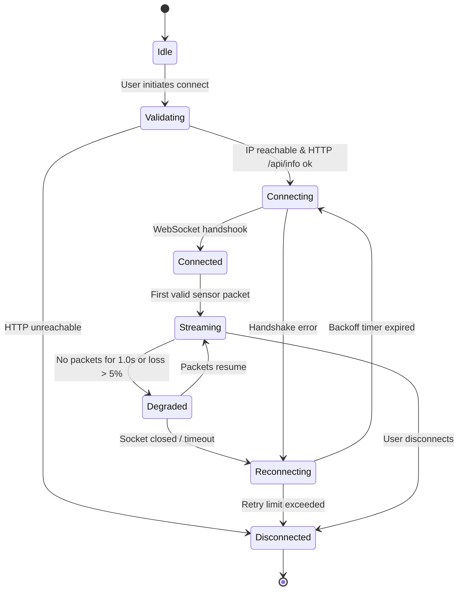

# H10 — Device Communication Protocol

The H10 glove and simulator communicate over standard Wi-Fi via HTTP REST control endpoints and a full-duplex WebSocket stream (`/ws/sensors`).

---

## 1. Connection Lifecycle State Machine



### Exponential Backoff Rules
When connection drops during an active exercise session, the session is **paused** (not aborted). The client attempts reconnection with exponential backoff:
$$T_{\text{backoff}} = \min(8.0, 0.5 \times 2^{\text{retry}})$$
Upon successful reconnection, the session resumes seamlessly, recording the gap duration in session metadata.

---

## 2. WebSocket Protocol (`ws://<host>:<port>/ws/sensors`)

### 2.1 Handshake Hello Frame
Immediately upon establishing the WebSocket link, the device transmits a JSON hello message:
```json
{
  "type": "hello",
  "protocol": 1,
  "firmware": "1.0.0",
  "rate_hz": 50,
  "encoding": "binary"
}
```
If `protocol != 1`, the client cleanly terminates the connection and alerts the user to upgrade firmware.

### 2.2 Binary Frame Format (30 Bytes Little-Endian)
The primary production transport format is 30 bytes per sample:

| Offset | Length | Type | Field Name | Units / Scale |
|---|---|---|---|---|
| 0 | 4 | uint32 | `timestamp_ms` | Milliseconds since device boot |
| 4 | 2 | uint16 | `flex_thumb` | Raw ADC (0–4095) |
| 6 | 2 | uint16 | `flex_index` | Raw ADC (0–4095) |
| 8 | 2 | uint16 | `flex_middle` | Raw ADC (0–4095) |
| 10 | 2 | uint16 | `flex_ring` | Raw ADC (0–4095) |
| 12 | 2 | uint16 | `flex_pinky` | Raw ADC (0–4095) |
| 14 | 2 | int16 | `ax` | Accelerometer X (mg, $\pm 16\text{g}$) |
| 16 | 2 | int16 | `ay` | Accelerometer Y (mg, $\pm 16\text{g}$) |
| 18 | 2 | int16 | `az` | Accelerometer Z (mg, $\pm 16\text{g}$) |
| 20 | 2 | int16 | `gx` | Gyroscope X ($0.1^\circ/\text{s}$, $\pm 2000^\circ/\text{s}$) |
| 22 | 2 | int16 | `gy` | Gyroscope Y ($0.1^\circ/\text{s}$, $\pm 2000^\circ/\text{s}$) |
| 24 | 2 | int16 | `gz` | Gyroscope Z ($0.1^\circ/\text{s}$, $\pm 2000^\circ/\text{s}$) |
| 26 | 2 | uint16 | `fsr` | Raw ADC (0 if unsupported) |
| 28 | 1 | uint8 | `flags` | Bit 0: Calibrated<br>Bit 1: Low Battery<br>Bit 2: Session Active |
| 29 | 1 | uint8 | `battery_pct` | Battery State of Charge (0–100%) |

### 2.3 JSON Fallback Frame Format
Used during simulator debugging or web clients unable to decode binary streams:
```json
{
  "v": 1,
  "t": 128450,
  "flex": [2150, 1820, 1940, 2010, 2200],
  "imu": [12, -980, 45, 0, 12, -4],
  "fsr": 0,
  "flags": 5,
  "battery": 92
}
```

---

## 3. Device HTTP REST API

Every HTTP endpoint returns a standardized JSON envelope:
```json
{
  "ok": true,
  "data": { ... },
  "request_id": "req_8f12a9c"
}
```
In case of error:
```json
{
  "ok": false,
  "error": {
    "code": "CALIBRATION_UNSTABLE",
    "message": "Signal noise standard deviation exceeded stability threshold."
  },
  "request_id": "req_8f12a9c"
}
```

### Endpoint Reference
- `GET /api/status`: Returns current battery percentage, uptime, stream rate, calibration status, and session active flag.
- `GET /api/info`: Returns firmware version, protocol version, hardware capabilities (`fsr_present`, `haptic_present`).
- `GET /api/calibration`: Returns stored finger calibration spans, medians, and calibration timestamp.
- `POST /api/calibration/open`: Captures resting open-hand baseline over requested duration (default 2000 ms).
- `POST /api/calibration/fist`: Captures closed-fist baseline over requested duration (default 2000 ms).
- `POST /api/session/start`: Initiates active recording session. Body: `{"session_id": "<uuid>"}`.
- `POST /api/session/stop`: Concludes active recording session. Body: `{"session_id": "<uuid>"}`.
- `POST /api/control/haptic`: Triggers haptic vibration pulse. Body: `{"motor": "index|both", "duration_ms": 200}`.
- `POST /api/control/rate`: Configures sensor stream rate (25 or 50 Hz). Body: `{"hz": 50}`.

