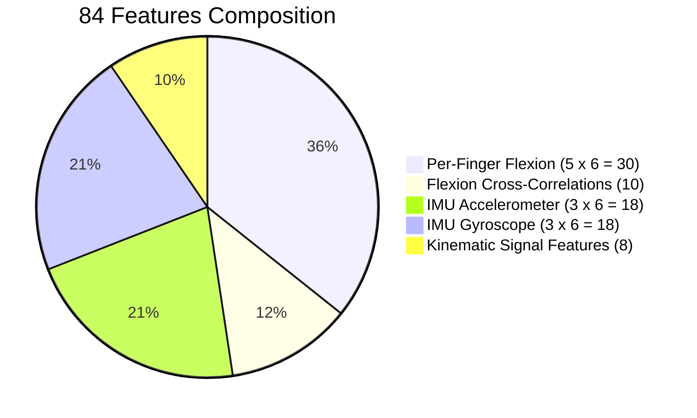

# H10 — Feature Schema v1 (`feat-v1`)

The `feat-v1` feature schema defines a standardized 84-dimensional feature vector extracted from 2.0-second sliding windows (100 samples at $50\text{ Hz}$).

---

## 1. Mathematical Parity Guarantee
The feature extraction code in pure Dart (`mobile/packages/h10_core/lib/features/features.dart`) and Python (`ml/features.py`) are strictly verified to produce bit-exact values within $< 10^{-6}$ numerical tolerance across all test vectors (`shared/fixtures/feature_golden_v1.json`).

---

## 2. Feature Breakdown (84 Dimensions)

### 2.1 Per-Finger Flexion Statistics (Indices 0–29: 5 fingers $\times$ 6 metrics)
For each finger $i \in \{0, 1, 2, 3, 4\}$ (Thumb, Index, Middle, Ring, Pinky):
1. **Mean ($\mu_i$):** Window average flexion.
2. **Standard Deviation ($\sigma_i$):** Window dispersion / amplitude of movement.
3. **Minimum ($\min_i$):** Lowest observed flexion in window.
4. **Maximum ($\max_i$):** Highest observed flexion in window.
5. **Range ($\Delta_i$):** Peak-to-peak dynamic excursion ($\max_i - \min_i$).
6. **Mean Absolute Diff (MAD$_i$):** Average step velocity ($\frac{1}{N-1} \sum |x[k] - x[k-1]|$).

### 2.2 Cross-Channel Finger Flexion Correlations (Indices 30–39: 10 pairs)
Pearson cross-correlation coefficient $r_{ij}$ between each pair of fingers $(i, j)$:
$$r_{ij} = \frac{\sum_{k=1}^N (x_i[k] - \bar{x}_i)(x_j[k] - \bar{x}_j)}{\sqrt{\sum_{k=1}^N (x_i[k] - \bar{x}_i)^2 \sum_{k=1}^N (x_j[k] - \bar{x}_j)^2}}$$
- Captures finger coupling vs isolated movement (e.g., finger tap shows low correlation with rest fingers, whereas fist clench shows high correlation across all fingers).

### 2.3 IMU Accelerometer Statistics (Indices 40–57: 3 axes $\times$ 6 metrics)
For each axis $a_x, a_y, a_z$:
1. Mean
2. Standard Deviation
3. Min
4. Max
5. Dynamic Range
6. Root Mean Square (RMS)

### 2.4 IMU Gyroscope Statistics (Indices 58–75: 3 axes $\times$ 6 metrics)
For each angular velocity axis $g_x, g_y, g_z$:
1. Mean
2. Standard Deviation
3. Min
4. Max
5. Dynamic Range
6. Energy ($\frac{1}{N} \sum g^2[k]$)

### 2.5 Aggregate Kinematic Signal Features (Indices 76–83: 8 metrics)
1. **Total Accelerometer Magnitude ($|\mathbf{a}|$):** Vector norm mean.
2. **Total Gyroscope Energy ($E_g$):** Vector angular energy.
3. **Flexion Synchrony Index ($S$):** Mean of the 10 pairwise correlation coefficients.
4. **Active Finger Count:** Number of fingers with dynamic range $\Delta_i \ge 20\%$.
5. **Dominant Finger Index:** Channel with highest peak-to-peak excursion ($0–4$).
6. **Flexion Velocity Peak:** Maximum first derivative across all flex channels.
7. **Zero-Crossing Rate (ZCR):** Number of mean crossings of primary control signal.
8. **Signal Crest Factor:** Peak amplitude divided by RMS amplitude.

