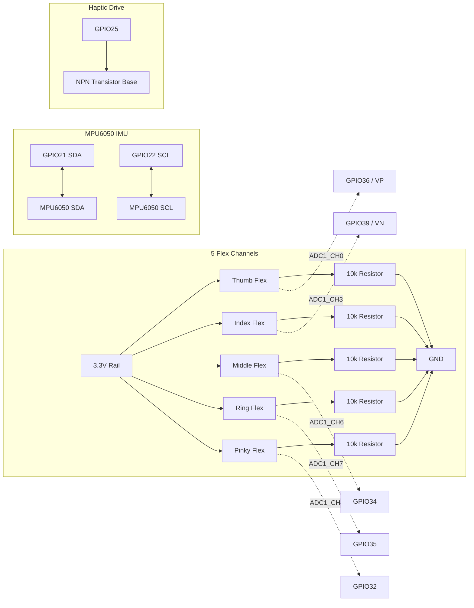

# H10 — Physical Hardware Integration Guide

This guide details the physical wiring, pinout configuration, and communication setup for deploying H10 firmware to an ESP32 DevKit V1 controller.

---

## 1. Bill of Materials (BOM)

| Component | Quantity | Role | Notes |
|---|---|---|---|
| **ESP32 DevKit V1** | 1 | Microcontroller, Wi-Fi Host, ADC Sampler | 30-pin or 38-pin package with onboard antenna. |
| **Flex Sensors (2.2" or 4.5")** | 5 | Thumb, Index, Middle, Ring, Pinky Flexion | Variable resistive elements ($10\text{k}\Omega–30\text{k}\Omega$). |
| **MPU6050 6-DOF IMU** | 1 | Wrist Orientation & Acceleration | I2C interface ($0x68$). |
| **Fixed Resistors ($10\text{k}\Omega$)** | 5 | Voltage Divider Completion | $1\%$ metal film resistors. |
| **Vibration Motor + Transistor** | 1–2 | Haptic Biofeedback Cues | NPN / MOSFET drive circuit with flyback diode. |
| **LiPo Battery (3.7V 1200mAh) + TP4056**| 1 | Portable Power & Charging | Clean 3.3V LDO regulated rail. |

---

## 2. Wiring & Pinout Table

> **IMPORTANT ADC RESTRICTION:**  
> On ESP32, **ADC2 pins cannot be used when Wi-Fi is active**. Therefore, all 5 flex sensor analog inputs are strictly wired to **ADC1** channels (`GPIO32`, `GPIO34`, `GPIO35`, `GPIO36`, `GPIO39`).

---

## 3. Firmware Sampling & Network Configuration
- **Flex Sampling:** Timer interrupt at $50\text{ Hz}$ ($20\text{ ms}$). ADC reads are averaged over 4 oversamples with a 12-bit attenuation ($0–3.3\text{V}$, $0–4095$ counts).
- **IMU Sampling:** Internal MPU6050 sample rate set to $100\text{ Hz}$, low-pass filter set to $42\text{ Hz}$, downsampled to $50\text{ Hz}$ in firmware FIFO.
- **Network Modes:**
  - **Access Point (AP) Mode:** ESP32 broadcasts SSID `H10-Glove-AP` (default gateway `192.168.4.1`). The mobile app connects directly.
  - **Station (STA) Mode:** ESP32 joins the local clinical Wi-Fi network; the user inputs the assigned DHCP IP address into the app settings.
