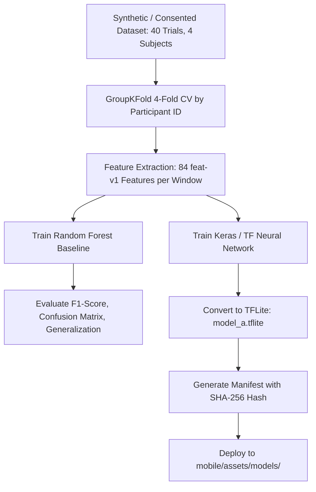

# H10 — Machine Learning Pipeline (Model A: Exercise Recognition)

Model A performs automated multi-class exercise recognition from kinematic glove telemetry.

> **TRAINING DEPLOYMENT DIRECTIVE**  
> Per system specifications and resource efficiency, heavy model training is orchestrated via **Google Colab** (`ml/colab/`), while local verification provides complete feature parity testing ($< 10^{-6}$), manifest validation, and on-device TFLite inference behind an experimental feature flag.

---

## 1. Machine Learning Task Definition
- **Input:** 2.0-second sliding window (100 samples at $50\text{ Hz}$) of 5-finger flex channels and 6-DOF IMU data.
- **Feature Vector:** `feat-v1`, an 84-dimensional engineered feature vector.
- **Classes (5):**
  1. `fist_clench`
  2. `finger_tap`
  3. `pinch`
  4. `wrist_rotation`
  5. `hand_control_game`
- **Model Architecture:**
  - Baseline: Random Forest Classifier ($N=100$ estimators, max depth 12).
  - Neural Network: Lightweight Multi-Layer Perceptron (84 $\to$ 64 $\to$ 32 $\to$ 5) with Dropout (0.2) converted to TensorFlow Lite (`.tflite`) for mobile on-device inference.

---

## 2. Google Colab Training Workflow

The complete training pipeline is packaged in:
- `ml/colab/train_colab.py`: Standalone CLI training script for Google Colab.
- `ml/colab/H10_Exercise_Recognition_Colab.ipynb`: Interactive Jupyter Notebook with GPU/CPU acceleration, dataset download, cross-validation evaluation, and TFLite model export.

### Participant Isolation (GroupKFold)
To prevent cross-subject data leakage and evaluate real-world clinical generalization, cross-validation strictly partitions data using `GroupKFold(n_splits=4)` grouped by `participant_id`. No participant's windows appear simultaneously in training and test splits.

---

## 3. On-Device Mobile Inference Architecture
- Located in `mobile/lib/services/model_service.dart`.
- Guarded by a user setting: *"Experimental ML Exercise Recognition"* (Disabled by default).
- Threshold Guard: Classification decisions require confidence $\ge 0.70$. If confidence $< 0.70$, the inference result is marked `uncertain`, preserving deterministic rule execution.
- Verification: SHA-256 cryptographic hash check matches `model_manifest.json` before loading model bytes.
