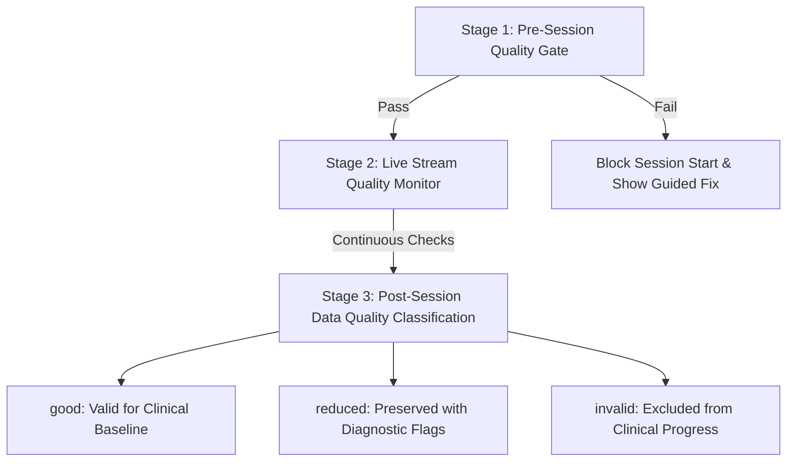

# H10 — Session Quality Gate

The Session Quality Gate ensures that exercise metrics and clinical flags are computed only from continuous, physiologically valid sensor streams.

---

## 1. Quality Gate Architecture

---

## 2. Gate Verification Rules

### 2.1 Stage 1: Pre-Session Check (Pre-Flight)
Before the patient can start an exercise recording:
1. **Device Connection:** WebSocket state must be `streaming` ($50\text{ Hz}$).
2. **Battery Level:** Battery state of charge must be $\ge 15\%$. If $< 15\%$, prompts patient to plug in glove.
3. **Calibration Validity:** Active calibration record must exist. If calibration is $> 14\text{ days}$ old, triggers warning: *"Calibration is older than 14 days; recalibration recommended for optimal accuracy."*
4. **Sensor Range Check:** Current resting flex ADC values must lie within valid electrical bounds ($50 \le \text{ADC} \le 4000$), ensuring no disconnected ribbon cables or short circuits.

### 2.2 Stage 2: Live Stream Health Monitoring
During active streaming, every packet is continuously verified:
- **Packet Loss / Dropouts:** Expected interval is $20\text{ ms}$ ($50\text{ Hz}$). Gaps $> 40\text{ ms}$ are tallied. Total dropped frames must remain $< 5\%$.
- **Decode Errors:** CRC, length errors, or out-of-range values must remain $< 1\%$.
- **Flatline Detection:** If any active exercise channel exhibits zero variance ($\sigma = 0$) over $3.0\text{ seconds}$ while the IMU indicates arm movement, surfaces flatline alert.
- **Link Degradation:** If no packets arrive for $1.0\text{ second}$, enters `degraded` state and pauses exercise timer.

### 2.3 Stage 3: Post-Session Quality Tagging
Upon session completion, the system assigns one of three categorical data quality ratings:
- **`good`:**
  - Packet loss $< 5\%$.
  - Decode error rate $< 1\%$.
  - Stream rate within $50 \pm 5\text{ Hz}$.
  - Zero channel flatlining detected.
  - Used for patient baseline calculations and clinician trend tracking.
- **`reduced`:**
  - Minor packet loss ($5\% \le \text{loss} \le 15\%$) or brief connection drop that resumed.
  - Retained in history but flagged for clinician awareness; excluded from automated baseline updates.
- **`invalid`:**
  - Uncalibrated glove, severe packet loss ($> 15\%$), or flatlined sensor channel during $> 25\%$ of session duration.
  - Excluded from recovery analytics; clinician alerted to inspect hardware.
