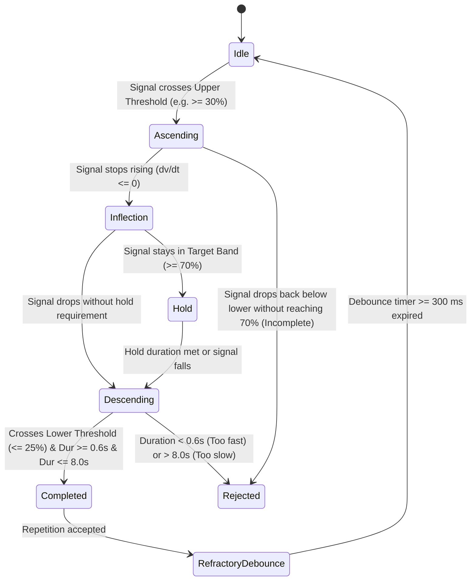

# H10 — Repetition Detection & Kinematic Metrics

Accurate, tamper-resistant repetition counting and kinematic scoring are governed by a dual-threshold hysteresis state machine and deterministic calculus metrics.

---

## 1. Hysteresis State Machine Architecture

Simple peak detection or zero-crossing algorithms produce severe double-counting errors in neuro-rehabilitation due to physiological tremor, hesitation, and compensatory twitches. H10 uses an 8-state hysteresis finite state machine:

### State Machine Rules & Thresholds
- **Lower Threshold ($T_{\text{lower}}$):** Default $25.0\%$ ROM.
- **Upper Threshold ($T_{\text{upper}}$):** Default $70.0\%$ ROM (configurable by clinician plan).
- **Hold Time Requirement ($T_{\text{hold}}$):** $0.5\text{ s}$ sustained within the target band.
- **Duration Validity Range:** $0.6\text{ s} \le \Delta t_{\text{rep}} \le 8.0\text{ s}$.
- **Debounce / Refractory Period:** $300\text{ ms}$ minimum refractory interval after descending below $T_{\text{lower}}$ before a subsequent repetition ascent can trigger.

---

## 2. Kinematic Metrics Formulation

### 2.1 Peak & Mean Range of Motion (ROM)
- **Peak ROM ($R_{\text{peak}}$):** Maximum excursion attained during the repetition:
  $$R_{\text{peak}} = \max_{t \in [t_{\text{start}}, t_{\text{end}}]} s(t)$$
- **Mean ROM ($R_{\text{mean}}$):** Numerical integral divided by repetition duration:
  $$R_{\text{mean}} = \frac{1}{t_{\text{end}} - t_{\text{start}}} \int_{t_{\text{start}}}^{t_{\text{end}}} s(t)\,dt$$

### 2.2 Dimensionless Jerk Smoothness ($D_J$)
In physical therapy, jerk (third derivative of displacement) quantifies movement coordination, spasticity, and motor control quality. To compare across repetitions of varying duration and amplitude, H10 computes the **Dimensionless Jerk**:

$$D_J = -\frac{(t_{\text{end}} - t_{\text{start}})^5}{(s_{\text{max}} - s_{\text{min}})^2} \int_{t_{\text{start}}}^{t_{\text{end}}} \left(\frac{d^3 s}{dt^3}\right)^2 dt$$

- Lower absolute magnitude indicates smoother, continuous coordinated motor execution.
- Jerky, spastic, or multi-effort movements exhibit high $|D_J|$ values.

### 2.3 Intra-Session Consistency Score ($C$)
Requires $\ge 3$ completed repetitions. Produces a composite score on a $0 \dots 100$ scale:

$$C = 100 \times \left(0.40 \cdot S_{\text{ROM}} + 0.35 \cdot S_{\text{time}} + 0.25 \cdot S_{\text{smooth}}\right)$$

Where:
- **ROM Ratio ($S_{\text{ROM}}$):** Excursion consistency:
  $$S_{\text{ROM}} = \text{clamp}\left(0.0, 1.0, \frac{\min(R_{\text{peak}})}{\max(R_{\text{peak}})}\right)$$
- **Timing Score ($S_{\text{time}}$):** Coefficient of variation (CV) of repetition durations:
  $$S_{\text{time}} = \text{clamp}\left(0.0, 1.0, 1.0 - \frac{\sigma_{\text{duration}}}{\mu_{\text{duration}}}\right)$$
- **Smoothness Score ($S_{\text{smooth}}$):** Consistency of jerk profiles across repetitions.

If fewer than 3 repetitions are completed, $C$ is reported as `unavailable` with the reason `"Requires >= 3 completed repetitions"`.

### 2.4 Fatigue Drop Index ($F$)
Requires $\ge 6$ completed repetitions. Evaluates neuromuscular endurance degradation by comparing the mean peak excursion of the first 3 repetitions against the last 3 repetitions:

$$\bar{R}_{\text{first}} = \frac{1}{3} \sum_{i=1}^3 R_{\text{peak}, i}, \quad \bar{R}_{\text{last}} = \frac{1}{3} \sum_{i=N-2}^N R_{\text{peak}, i}$$

$$\text{Drop}\% = \frac{\bar{R}_{\text{first}} - \bar{R}_{\text{last}}}{\bar{R}_{\text{first}}} \times 100.0$$

- **Fatigue Detected:** Triggered when $\text{Drop}\% \ge 20.0\%$ (or custom plan threshold).
- **Clinical Implication:** Indicates excessive patient fatigue or unsustainable repetition volume, advising rest.
