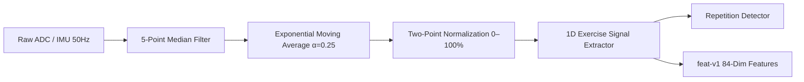

# H10 — Signal Processing Pipeline

The signal processing pipeline converts raw ADC voltage levels and IMU measurements into smooth, normalized kinematic control variables.

---

## 1. Pipeline Stages

---

## 2. Digital Filters

### 2.1 5-Point Median Filter (`MedianFilter`)
- **Purpose:** Eliminates single-sample impulse noise, high-frequency voltage spikes, and intermittent sensor contact bounce without introducing phase delay or attenuating true physiological peaks.
- **Algorithm:** Maintains a sliding window of the last 5 samples $W = [x_0, x_1, x_2, x_3, x_4]$. Returns the median (3rd sorted element):
  $$y[k] = \text{median}(x[k-4 \dots k])$$

### 2.2 Exponential Moving Average (`EmaFilter`)
- **Purpose:** Smooths residual sensor jitter and baseline tremor while preserving natural hand motion dynamics.
- **Equation:**
  $$y[k] = \alpha \cdot x[k] + (1 - \alpha) \cdot y[k-1]$$
- **Default Parameter:** $\alpha = 0.25$ (at $50\text{ Hz}$, equivalent to a $-3\text{ dB}$ cutoff frequency $f_c \approx 2.3\text{ Hz}$).

---

## 3. Two-Point Normalization
Flex sensor resistance varies between individual hardware strips, glove fabric tension, and hand geometry. The signal engine normalizes raw ADC counts into calibrated Range of Motion percentage ($0.0 \dots 100.0\%$):

$$\text{ROM}\% = \text{clamp}\left(0.0, 100.0, \frac{\text{ADC}_{\text{live}} - \text{ADC}_{\text{open}}}{\text{ADC}_{\text{fist}} - \text{ADC}_{\text{open}}} \times 100.0\right)$$

If polarity is inverted (resistance decreases with flexion), polarity $P = -1$ flips the numerator:
$$\text{ROM}\% = \text{clamp}\left(0.0, 100.0, \frac{\text{ADC}_{\text{open}} - \text{ADC}_{\text{live}}}{\text{ADC}_{\text{open}} - \text{ADC}_{\text{fist}}} \times 100.0\right)$$

---

## 4. 1D Exercise Signal Extractor
Different exercises map to different primary kinematic channels:
- **Fist Clench & Release:** Mean flexion of all 5 normalized finger channels:
  $$s_{\text{fist}}[k] = \frac{1}{5} \sum_{i=0}^4 f_i[k]$$
- **Single-Finger Tapping:** Isolated flexion of the target finger (index finger by default):
  $$s_{\text{tap}}[k] = f_{\text{index}}[k]$$
- **Thumb-Index Pinch:** Mean flexion of thumb and index finger:
  $$s_{\text{pinch}}[k] = \frac{f_{\text{thumb}}[k] + f_{\text{index}}[k]}{2}$$
- **Forearm Rotation (Pronation / Supination):** Trapezoidal numerical integration of the forearm-axis gyroscope ($g_y$):
  $$\theta[k] = \theta[k-1] + g_y[k] \cdot \Delta t$$
  Normalized against prescribed target angle (e.g. $\pm 60^\circ$).

