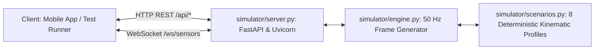

# H10 — Hardware Simulator & Scenarios

The H10 Simulator (`simulator/`) is an asynchronous Python server replicating an ESP32 glove over HTTP REST and WebSocket streams, enabling deterministic testing without physical hardware.

---

## 1. Simulator Architecture



- **Frequency:** Streams synthesized packets at $50\text{ Hz}$ ($20\text{ ms}$ tick interval).
- **Transport Modes:** Supports both 30-byte little-endian binary frames and JSON fallback envelopes.
- **Port:** Default HTTP/WS on `127.0.0.1:8000` (or `8001` when run alongside backend).

---

## 2. Deterministic Scenarios (`simulator/scenarios.py`)

The simulator provides 8 deterministic scenarios designed to rigorously test edge cases across the signal pipeline:

| Scenario ID | Name | Duration | Behavior & Mathematical Profile | Purpose / Target Test |
|---|---|---|---|---|
| `scen_01` | `open_hand_rest` | 10.0 s | Flat baseline: flex ADC $1200 \pm 10$, IMU at rest with gravity on $a_z$. | Calibration Stage 1 stability test; drift detection. |
| `scen_02` | `fist_repetitions` | 25.0 s | 10 clean, rhythmic fist repetitions (half-sine flex pulses, amplitude $85\%$, duration $1.8\text{ s}$, rest $0.8\text{ s}$). | Repetition detection baseline; consistency score $\approx 90\%$. |
| `scen_03` | `fast_repetitions` | 10.0 s | Rapid flutter flexions with duration $< 0.5\text{ s}$. | Verifies state machine rejects too-fast repetitions. |
| `scen_04` | `incomplete_repetitions` | 15.0 s | Hesitant flexions peaking at $50\%$ ROM (below $70\%$ upper threshold). | Verifies state machine rejects incomplete repetitions. |
| `scen_05` | `finger_tapping_index` | 20.0 s | Isolated index finger flexion pulses while thumb, middle, ring, pinky remain at rest. | Finger isolation test; tapped finger feature extraction. |
| `scen_06` | `pinch_series` | 20.0 s | Synchronous flexion of thumb and index finger with minimal movement on other fingers. | Precision grip validation; cross-channel correlation. |
| `scen_07` | `wrist_rotation` | 20.0 s | Sinusoidal forearm pronation/supination gyro oscillation ($g_y = \pm 120^\circ/\text{s}$). | Gyro numerical integration and angle calculation. |
| `scen_08` | `fault_injection` | 15.0 s | Periodic packet drops (gaps $> 60\text{ ms}$), flex ADC spikes ($> 4095$), and random battery drain. | SessionQualityGate degradation and error recovery. |

---

## 3. Running the Simulator
To run the simulator standalone:
```bash
python -m simulator.server --port 8000 --rate 50 --scenario fist_repetitions
```
To run automated scenario tests:
```bash
pytest simulator/test_simulator.py
```
