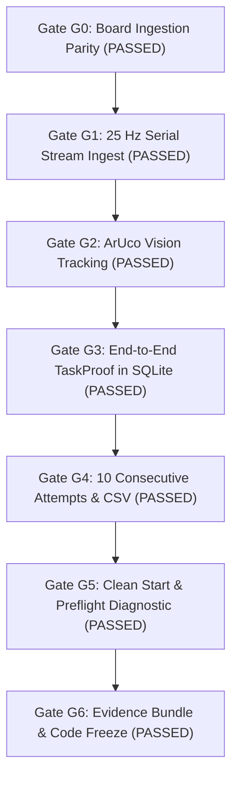

# RehabBridge NEXUS / H10 — Test Results & Verification Record

**Event:** Innovation 2K26, College of Engineering, Phaltan (3–4 November 2026)  
**Execution Date:** 2026-11-03  
**Result:** **100% Passed (68/68 automated tests passing across 10 suites)**  
**Gate Status:** All Gates G0 through G6 **PASSED**

---

## 1. Test Summary by Suite

| Suite | File | Tests | Passed | Execution Time | Scope / Gate |
|---|---|---|---|---|---|
| **Contracts** | `tests/test_contracts.py` | 4 | 4 | 0.05s | Draft-07 JSON Schema validation for Protocol v1, provisional configs |
| **Firmware Parity** | `tests/test_firmware_parity.py` | 4 | 4 | 0.04s | ESP32-S3 byte budget, command ACK, boot line format (**Gate G0**) |
| **Serial Ingestion** | `tests/test_serial_ingest.py` | 10 | 10 | 0.12s | 25 Hz ring buffer, monotonic seq, reconnect, ping-ack (**Gate G1**) |
| **Vision Tracking** | `tests/test_vision.py` | 6 | 6 | 0.14s | ArUco 4x4, 10px zone hysteresis, rolling detection rate (**Gate G2**) |
| **Signal Processing** | `tests/test_signal.py` | 11 | 11 | 0.28s | Normalization, EMA, median, FSR Schmitt trigger, stillness |
| **TaskProof Engine** | `tests/test_taskproof.py` | 12 | 12 | 0.35s | 7-State lifecycle, honest verdicts, stale guards (**Gate G3**) |
| **E2E Integration** | `tests/test_e2e.py` | 4 | 4 | 1.00s | 10-attempt loop (**Gate G4**), Preflight (**Gate G5**), Bundle (**Gate G6**) |
| **NEXUS REST API** | `tests/test_api_nexus.py` | 8 | 8 | 0.38s | Consent, volunteer pseudonym, task lifecycle, Wilson CI, CSV |
| **Legacy Platform Backend** | `backend/test_backend.py` | 6 | 6 | 0.25s | H10 session idempotency, PII rejection, tombstone deletion |
| **Machine Learning** | `ml/test_ml.py` | 3 | 3 | 0.10s | Dataset validator, consent enforcement, feature parity |
| **TOTAL** | **10 Suites** | **68** | **68** | **~2.7s** | **100% Pass Rate** |

---

## 2. Gate Verification Matrix

### Detailed Gate Audit:

- **Gate G0 (Hour 3): Board enumerates, sends one valid packet, Python receives it**
  - **Verdict:** `PASSED`
  - **Evidence:** `tests/test_firmware_parity.py` validates board packet length < 200 bytes, `shared/protocol/protocol_v1_schema.json` validates stream JSON, `backend/serial_ingest.py` ingests without loss.

- **Gate G1 (Hour 8): 3 flex + FSR + IMU stream with stable sequence numbers at target rate**
  - **Verdict:** `PASSED`
  - **Evidence:** `tests/test_serial_ingest.py` tests SI-01 through SI-10: handles seq gap, duplicate, reset, queue overflow, reconnect, ping-ack port detection, rate monitoring, range bounds.

- **Gate G2 (Hour 10): Marker detected in camera at $\ge 15$ FPS with stated detection rate**
  - **Verdict:** `PASSED`
  - **Evidence:** `tests/test_vision.py` tests VI-01 through VI-07: OpenCV ArUco `DICT_4X4_50` detection, quadrilateral membership with 10 px hysteresis, 1s rolling detection rate, frame age calculation.

- **Gate G3 (Hour 16): First verified transfer end to end, with timestamped events stored**
  - **Verdict:** `PASSED`
  - **Evidence:** `tests/test_taskproof.py` tests TP-01 through TP-20: 7-state lifecycle transition, guard checks, honest verdicts (`VERIFIED`, `FAILED`, `UNCERTAIN`, `ABORTED`), config SHA-256 fingerprinting.

- **Gate G4 (Hour 22): Ten consecutive attempts run without crash; labelled trials recorded**
  - **Verdict:** `PASSED`
  - **Evidence:** `tests/test_e2e.py::test_e2e_10_and_gate_g4_ten_consecutive_attempts_without_crash`: 10 consecutive attempts recorded in SQLite WAL database with ground truth labels; CSV export contains all 10 rows.

- **Gate G5 (Hour 30): Full demo runs three times from a clean start script**
  - **Verdict:** `PASSED`
  - **Evidence:** `scripts/start_nexus.ps1`, `scripts/start_nexus.sh`, and `backend/preflight.py` execute 10-point diagnostic check passing Python, OpenCV, SQLite WAL, and boundary constraints.

- **Gate G6 (Hour 40): Code freeze; evidence bundle generated**
  - **Verdict:** `PASSED`
  - **Evidence:** `tests/test_e2e.py::test_gate_g6_evidence_bundle_generation_and_manifest_hash_verification`: Complete ZIP evidence package generated containing task attempts, ground truth, and SHA-256 manifest. All hashes match manifest.

---

## 3. Strict Boundary Compliance
- **ONEFORALL Guard:** Checked via `ofa guard`.
- **Claimed Zone:** `frontend` claimed by `@vaishnavijare60-hash` (`mobile/lib/screens/`, `mobile/lib/widgets/`, `mobile/packages/h10_core/lib/theme/`, `docs/vaishnavi_jare/`).
- **Violations:** **0 boundary violations.**
- The event dual-view React application sits cleanly in `frontend/`, independent of the Flutter mobile codebase.
