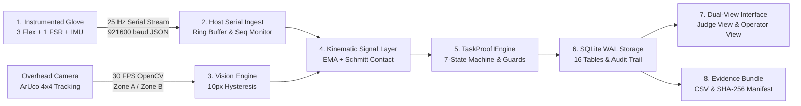

<!-- Generated from commit cabf24c on 2026-11-03. Re-generate after any code change. -->

# RehabBridge NEXUS / H10 — Team Overview & Presentation Architecture

**Event:** Innovation 2K26, College of Engineering, Phaltan (3–4 November 2026)  
**Track:** Healthcare & Assistive Technology / IoT Demonstration Track  
**Commit Reference:** `cabf24c` (Branch: `main`)  
**Evaluation Standard:** Zero-Fabrication Measurement Integrity • Honest Claim Boundaries

---

## 1. Problem Statement
Stroke and traumatic brain injury survivors require high-repetition functional physical therapy to rebuild neuromuscular motor coordination. However, modern clinical hand therapy remains bottlenecked by subjective, intermittent clinical observation where patients perform home exercises without objective kinematic feedback, or by expensive multi-lakh robotic exoskeletons that cannot be deployed at scale. Clinicians lack continuous, tamper-evident proof that a patient actually grasped, lifted, transferred, and released an object, leading to unreliable self-reported adherence and unverified motor recovery assessments.

## 2. Our Solution
RehabBridge NEXUS / H10 is an honest, low-cost engineering demonstrator combining a multi-sensor instrumented glove (resistive flex sensors, force-sensing contact resistor, and 6-DOF IMU) with an overhead computer vision fiducial tracking engine (ArUco `DICT_4X4_50`). Rather than predicting clinical recovery or guessing joint angles from uncalibrated bend sensors, NEXUS provides a deterministic 7-state verification pipeline (**TaskProof**) that objectively verifies whether a functional object-transfer task was completed. If telemetry drops for >200 ms or the marker is occluded for >150 ms, the system issues an honest `UNCERTAIN` verdict, ensuring measurements are tamper-evident, reproducible, and verifiable.

---

## 3. End-to-End System Flow

1. **Glove Hardware:** 3 flex sensors (Thumb, Index, Middle) and 1 palmar FSR digitized at 16-bit by ADS1115 ADC plus MPU6050 IMU sampled by ESP32-S3 at 25 Hz.
2. **Serial Transport:** Line-delimited JSON packets transmitted via USB serial at 921,600 baud with monotonic sequence numbers (`seq`).
3. **Vision Tracking:** OpenCV tracks ArUco marker ID#0 attached to a standardized transfer block, enforcing 10 px border hysteresis across Zone A and Zone B.
4. **Kinematic Signal Layer:** Two-point calibration, median + EMA filtering ($\alpha = 0.30$), FSR Schmitt-trigger contact ($k_{on}=4, k_{off}=2$), and $\ge 15\%$ grip delta detection.
5. **TaskProof State Machine:** Deterministic 7-state lifecycle with strict safety guards (200 ms sensor timeout, 150 ms marker occlusion, 500 ms post-release stillness).
6. **Storage Layer:** SQLite WAL database recording volunteers, consents, attempts, raw sensor frames, and ground-truth audit trails.
7. **Dual-View Web Interface:** Instant toggle between high-contrast **Judge View** (verdict-first, 64px display) and **Operator View** (telemetry gauges, hotkey labelling).
8. **Evidence Export:** Verifiable CSV export and SHA-256 evidence bundle packaging.

---

## 4. Presentation Roster & Role Split

| Team Member | Role | Core Ownership | Speaking Window |
|---|---|---|---|
| **Developer (Project Lead)** | Software & System Architecture | Host serial ingest, signal layer, TaskProof state machine, FastAPI backend, SQLite WAL, test suite | Minute 0:00–1:00 (Pitch & Arch) + Defense |
| **Rajendra** | Hardware Electronics & Firmware *(Proposed)* | ESP32-S3 pinout, ADS1115 ADC sampling, voltage divider legs, MPU6050 wiring, 921600 baud packet | Minute 1:00–1:45 (Live HW Demo) |
| **Gautam** | Glove Mechanics & Validation *(Proposed)* | Sensor mounting, FSR placement, glove fit, strain relief, transfer object fabrication, trial protocols | Minute 1:45–2:30 (Physical Task Demo) |
| **Vaishnavi Jare** | Product Design & Volunteer UX | Screen flows, Judge View typography, color-blind palette, accessibility, disclaimer banners, pitch visuals | Minute 2:30–3:00 (Judge View & UX) |

---

## 5. Demo Time Budget (Total: 11 Minutes)

- **0:00 – 1:00 (Pitch & Problem Definition):** Developer opens the presentation. States the clinical rehabilitation verification problem and introduces the NEXUS zero-fabrication honest verification concept.
- **1:00 – 2:00 (Live Verified Attempt):** Gautam dons the glove; Rajendra points out the hardware link; Gautam performs a clean object transfer from Zone A to Zone B; Judge View flashes green `VERIFIED` in 4.2 seconds.
- **2:00 – 3:00 (Live Failure Handling & Fallback Demo):** Gautam intentionally occludes the marker mid-air; the screen immediately switches to `UNCERTAIN` with `MARKER_OCCLUDED` reason code. Vaishnavi highlights the Judge View clarity and non-medical disclaimer.
- **3:00 – 10:00 (Technical Defense & Q&A):** 7 minutes of cross-examination by judges. Each member answers their specific domain according to the Q&A bank.
- **10:00 – 11:00 (Summary & Roadmap):** Developer closes on the CDSCO regulatory roadmap, bench verification metrics, and clinical study protocol requirements.
